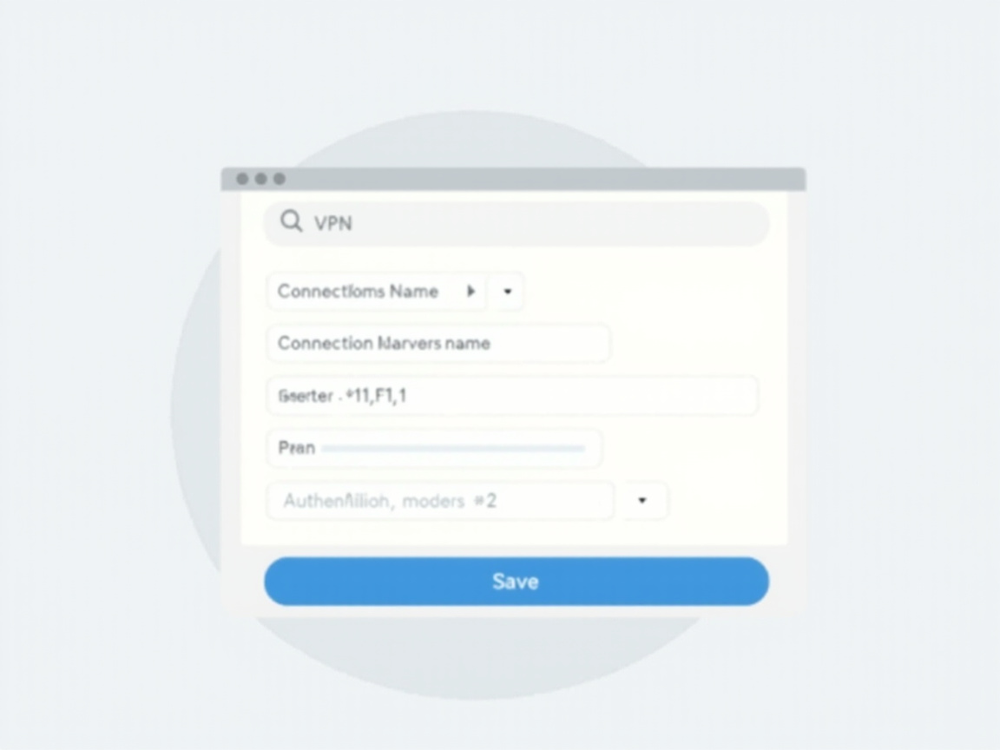

# 🔒 FortiClient VPN — Hospital das Clínicas FMUSP

  

  <strong>Guia ilustrado para instalar, configurar e conectar à VPN institucional do HC FMUSP.</strong>

  
  
  
  

---

## 📋 Sobre

A VPN do HC permite acesso seguro aos sistemas internos (prontuário eletrônico, intranet, sistemas administrativos, drives compartilhados) **de fora do hospital**. Este repositório documenta o processo oficial, baseado na cartilha do **NETI** (Núcleo Especializado em Tecnologia da Informação) — versão 2.1, 2022.

**Gateway:** `vpn.hc.fm.usp.br:443` (SSL-VPN)

## 🏗️ Como funciona

  

O FortiClient cria um **túnel SSL criptografado** entre seu dispositivo e o gateway do HC. Todo o tráfego passa por dentro desse túnel, protegido contra interceptação.

## ✅ Pré-requisitos

Antes de começar, você precisa de:

- [ ] **Credenciais corporativas ativas** (mesmo user/senha do e-mail `@hc.fm.usp.br`)
- [ ] **Conexão com a internet** (cabo, Wi-Fi ou 4G)
- [ ] **Permissão de administrador** no dispositivo (para instalar o FortiClient)
- [ ] **E-mail corporativo** validado (teste em https://mail.hc.fm.usp.br)

## 📥 Instalação

### Passo 1: Download

1. Acesse: [**fortinet.com/br/support/product-downloads**](https://www.fortinet.com/br/support/product-downloads)
2. Clique em **"Somente FortiClient VPN"**
3. Selecione o instalador do seu sistema operacional:
   - **Windows:** `FortiClientVPNOnlineInstaller_7.0.exe`
   - **macOS:** `FortiClientVPNOnlineInstaller_7.0.dmg`
   - **Linux:** `.deb` (Debian/Ubuntu) ou `.rpm` (RHEL/Fedora)

### Passo 2: Instalação

**Windows (10/11):**
1. Clique duplo no `.exe` baixado
2. Aguarde a barra de status chegar em "Avançar/Instalar"
3. Clique em **Install**
4. Clique em **Finish** ao concluir

**macOS:**
1. Abra o `.dmg` baixado
2. Arraste o ícone do FortiClient para **Aplicativos**
3. Autorize em **Configurações → Segurança e Privacidade** se solicitado

**Linux (Debian/Ubuntu):**
1. `sudo dpkg -i forticlient_vpn_*.deb`
2. Inicie pelo menu de aplicações ou: `forticlient`

## ⚙️ Configuração

### Passo 3: Criar o perfil VPN

1. Abra o FortiClient
2. Clique em **"Configurar a VPN"** (ou "Configure VPN")
3. Selecione **"Remote Access"**

  

4. Preencha os campos **exatamente** assim:

| Campo | Valor |
|-------|-------|
| VPN | `SSL-VPN` |
| Connection Name | `VPN_HC` |
| Remote Gateway | `vpn.hc.fm.usp.br` |
| Customize Port | `443` |
| Authentication | `Prompt on Login` |

5. Clique em **"Save"**

## 🔐 Conexão

### Passo 4: Conectar

1. No FortiClient, selecione o perfil **`VPN_HC`**
2. Clique em **"Conectar"**
3. Quando solicitado, insira:
   - **Usuário:** seu user **sem** o `@hc.fm.usp.br`
     - Exemplo: e-mail `fulano@hc.fm.usp.br` → user `fulano`
   - **Senha:** a mesma do e-mail corporativo
4. Aguarde o status mudar para **"Conectado"** 🟢
5. Pronto! Você já pode acessar os sistemas internos do HC.

## 🛠️ Troubleshooting

### ❌ "Login failed"
- Verifique se o usuário está **sem** o `@hc.fm.usp.br`
- Confirme que a senha é a do **e-mail corporativo** (não a de rede/AD)
- Teste o login em https://mail.hc.fm.usp.br
- Se acabou de trocar a senha, aguarde ~15 min para sincronizar

### ❌ "Unable to establish VPN" / timeout
- Confirme sua conexão com a internet
- Teste o gateway: `ping vpn.hc.fm.usp.br`
- Tente a porta alternativa: **`10443`** em vez de `443`
- Desative firewall/antivírus temporariamente
- Se estiver em rede corporativa, tente de outra rede (4G)

### ❌ "Certificate error"
- Aceite o certificado do Fortinet quando solicitado
- Se persistir, reinstale o FortiClient
- Verifique a data/hora do sistema

### ❌ VPN conecta mas não acessa sistemas
- Verifique se está no perfil **`VPN_HC`**
- Teste: `nslookup intranet.hc.fm.usp.br`
- Contate o NETI para verificar permissões da sua conta

## 📞 Suporte

- **NETI/HC-FMUSP:** helpdesk interno do hospital
- **Webmail HC:** https://mail.hc.fm.usp.br (teste de credencial)
- **Fortinet Downloads:** https://www.fortinet.com/br/support/product-downloads

## 📄 Créditos

- **Fonte:** Cartilha de Instalação do FortiClient — **NETI/HC-FMUSP**, versão 2.1, 2022
- **Mantido por:** [Maverick591](https://github.com/Maverick591)

## 📜 Licença

Este projeto está licenciado sob a **MIT License** — veja o arquivo [LICENSE](LICENSE) para detalhes.
